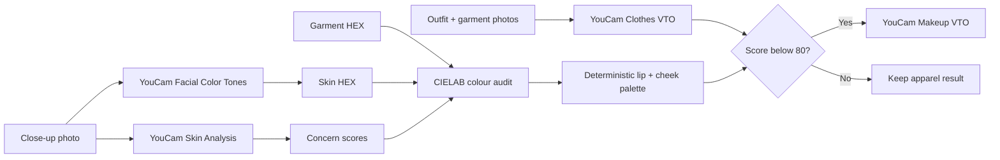

# AuraSync

> See your full look before you spend on the wrong one.

AuraSync is a personal styling studio for shoppers who need to make clothing and beauty choices together, not as separate guesses. It combines complexion colour, a garment, and a makeup palette into one transparent styling flow.

Built for the [YouCam API Skin AI & eCommerce VTO Hackathon](https://youcam-api-skin-ai-ecommerce.devpost.com/).

## Why AuraSync

An outfit can look perfect online and still feel wrong when it arrives: the colour can wash out the face, makeup no longer sits with the garment, and the moment it was bought for is already close.

AuraSync responds to that decision before checkout. It is designed around an everyday Nigerian shopping moment: getting ready for an owambe, a job interview, Sunday service, graduation, or an important meeting, where a last-minute clothing mismatch costs time, money, and confidence.

It does **not** rate beauty, diagnose skin, predict fit, or promise fewer returns. Its colour score is an explainable styling comparison.

## What it does

### Sample studio

Works without an API key.

- Choose from three sample complexion profiles.
- Browse four garment colours.
- Inspect a CIELAB colour-harmony report.
- Review suggested lip, cheek, and garment swatches.
- Compare an illustrative three-stage look for the featured sample pairing.

All sample imagery is explicitly labelled as illustrative. It is not presented as YouCam output.

### Live styling workflow

Uses the YouCam API after a server-side API key is configured.

1. Upload a close-up face photo.
2. Run YouCam Skin Analysis and Facial Color Tones Analyzer.
3. Upload an outfit photo and a garment product image.
4. Run YouCam Clothes Virtual Try-On.
5. Review AuraSync's transparent colour comparison.
6. When the pairing needs a colour bridge, run YouCam Makeup Virtual Try-On.

The application records task metadata and archives successful output images locally to reduce dependence on temporary provider URLs.

## How it works



### Explainable colour logic

AuraSync converts HEX colours from sRGB to CIELAB and compares:

- **ΔE76 colour distance**
- **Lightness contrast**
- **Warmth / undertone relationship**
- **A redness-related flag**, only when YouCam provides a live redness score

The score begins at 92 and deducts documented styling penalties. The proposed lip and cheek shades are calculated from the complexion and garment colours; they are not generated by a language model.

## Stack

- Next.js 16 and React 19
- TypeScript
- Tailwind CSS v4
- Base UI and Lucide
- YouCam Skin Analysis
- YouCam Facial Color Tones Analyzer
- YouCam Clothes Virtual Try-On
- YouCam Makeup Virtual Try-On
- CIELAB colour math
- Node.js route handlers and local SHA-256 caching

## Run locally

### Prerequisites

- Node.js 20+
- A YouCam API account and API key for live mode

### Installation

```bash
git clone https://github.com/salaudeenabdulkabir/AuraSync.git
cd AuraSync
npm install
```

Create `.env.local` in the project root:

```dotenv
YOUCAM_API_KEY=your_youcam_api_key
```

Run the development server:

```bash
npm run dev
```

Open [http://localhost:3000](http://localhost:3000).

The **Sample studio** works without the key. Use **Use my photos** only after adding `YOUCAM_API_KEY`.

## Commands

| Command | Purpose |
| --- | --- |
| `npm run dev` | Start the local development server |
| `npm run build` | Create a production build and type-check the app |
| `npm start` | Serve a production build |
| `npm run lint` | Run ESLint |
| `npm test` | Run colour-engine tests |
| `npm run verify:youcam -- <face.jpg> --live` | Opt-in live skin-analysis smoke test |

The live smoke test requires `YOUCAM_API_KEY` to be available to the shell. It can use API units.

## Input guidance

| Input | Use |
| --- | --- |
| Close-up face photo | Skin analysis and complexion colour |
| Outfit/body photo | Source for apparel virtual try-on |
| Garment product image | Clothing to apply in virtual try-on |

Use JPEG or PNG images under 10 MB. Only use photos you are allowed to upload.

## Current project status

The sample experience, interface, colour engine, local cache, and YouCam API routes are implemented. The production submission should use verified live outputs from consented images, a public video showing the end-to-end experience, and a deployed testing link.

## Integrity and privacy

- API credentials belong only in `.env.local`, never in source control.
- `.env.local`, cached API responses, and archived outputs are ignored by Git.
- Sample portraits and garments are generated project assets and are labelled as samples in the interface.
- Live uploads are sent to YouCam only when the user starts a live action.
- The application does not make medical, attractiveness, fit, conversion, or return-rate claims.

## License

[MIT](LICENSE)
